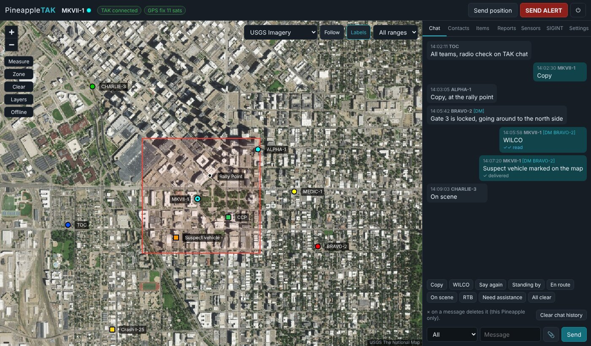
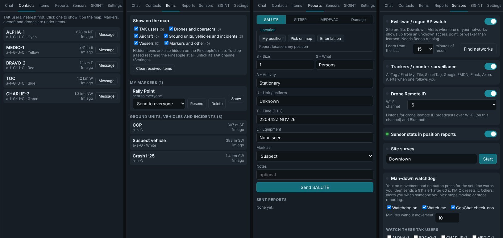
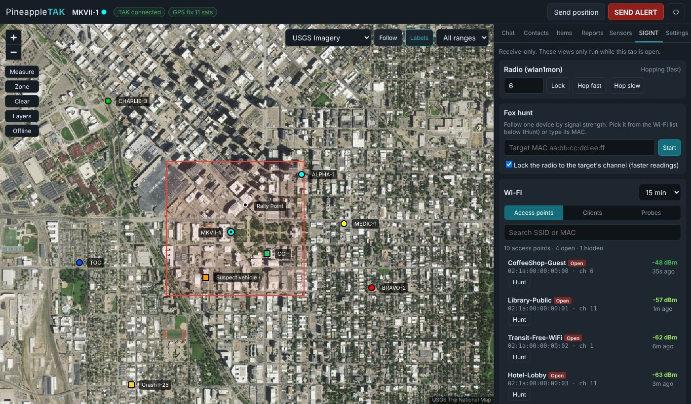

# PineappleTAK – TAK for the [WiFi Pineapple Mark VII](https://hak5.org/products/wifi-pineapple)

<p align="center"></p>

[](https://www.buymeacoffee.com/sect0101)

A **Pineapple UI module** that connects the **Hak5 WiFi Pineapple Mark VII** to your **TAK Server**, so it shows up on ATAK, WinTAK, iTAK, WebTAK and CloudTAK like any other team member. It sends its position, does GeoChat, alerts and reports, and turns the Pineapple's radios into TAK sensors.

PineappleTAK is the Mark VII edition of [PagerTAK](https://github.com/SECT0101/PagerTAK) and runs the same engine and web console. **It is a community module and is not supported or guaranteed by Hak5.** See [Legal](#legal).



---

## What it does

- **Position** from a USB GPS (u-blox and other NMEA receivers) or a position you set on the map. Sent as CoT, with the Pineapple's recon stats in the remarks if you want them.
- **GeoChat** with All Chat Rooms and direct messages, quick messages, and *delivered* / *read* receipts.
- **Alerts**: 911, Ring The Bell, Geo-fence Breached, Troops In Contact or a custom alert, to everyone or chosen contacts.
- **Reports**: SALUTE, SITREP, MEDEVAC 9-line and damage reports.
- **Sensors**, all receive-only:
  - Evil-twin / rogue AP watch: learn your site's networks from recon, then get an alert when one of them shows up from an unknown access point or with weaker security.
  - Trackers / counter-surveillance with a USB Bluetooth adapter: AirTag / Find My, Tile, SmartTag, Google FMDN, Flock and Axon. It alerts when one follows you.
  - Drone Remote ID over Wi-Fi and Bluetooth, with drones and operators on the map.
  - Site survey, packaged and uploaded to TAK.
  - Geofences and a man-down watchdog.
- **SIGINT tab**: radio control, fox hunt, and access point, client and probe tables from PineAP recon.
- **Map tools**: markers, zones, measure, TAK channels, offline maps, KML / KMZ overlays and file sharing.
- **Setup in the browser**: TAK Server certificate enrollment with your TAK username and password, ATAK connection package import, or .p12 / PEM upload.

## Screenshots

The web console runs on the Pineapple and opens in any browser on your laptop or phone. These shots use made-up demo data.





## Install

You need a WiFi Pineapple Mark VII on firmware 2.0 or newer, with internet access for the first install.

1. Download `PineappleTAK-<version>.tar.gz` from [Releases](../../releases).
2. Copy it to the Pineapple and unpack it into the modules folder:
   ```bash
   scp PineappleTAK-1.0.2.tar.gz root@172.16.42.1:/tmp/
   ssh root@172.16.42.1 'tar xzf /tmp/PineappleTAK-1.0.2.tar.gz -C /pineapple/modules/'
   ```
3. Reload the Pineapple UI and open **Modules > PineappleTAK**.
4. Press **Install**. It adds what is missing (`bash`, `python3-sqlite3`, `ca-bundle`) and sets up the PineappleTAK service.
5. Set a password for the web console, then press **Open PineappleTAK**. The console answers on port 8484 at the Pineapple's host name, its IP on your network and `http://172.16.42.1:8484`. *Console access* on the module page can limit it to the USB address or USB + VPN.
6. Set up the TAK Server connection in the console: enroll with your TAK username and password, import an ATAK connection package, or upload certificates.

Turn on **Start at boot** on the module page to have PineappleTAK connect every time the Pineapple starts.

**Optional hardware**
- A USB GPS for live position. Without one, set your position with *Pick on map* in the console.
- A USB Bluetooth adapter for the tracker watch. The Sensors tab installs the Bluetooth tools when you first need them.

**Updating:** unpack the new version over the old one and press **Reinstall** on the module page. Your settings, certificates, markers, zones and site profiles are kept. See the [changelog](CHANGELOG.md).

## Repository layout

```
pineappletak/            # the service that runs on the Pineapple (/root/pineappletak)
├── pineappletak.sh      # starts the engine, sensors and web console without a screen
├── mk7/                 # Mark VII layer: LEDs, USB GPS, PineAP recon, settings store
└── core/                # PagerTAK's engine, sensors and web console (shared with PagerTAK)
module/PineappleTAK/     # the Pineapple UI module (Angular page + module.py)
tools/build-module.sh    # builds PineappleTAK-<version>.tar.gz
docs/                    # logo and screenshots
```

To build the module yourself you need Node.js and npm. Then run `tools/build-module.sh` from the repository root.

**About the security alerts:** `module/PineappleTAK/package-lock.json` lists the Angular 9 build tools from Hak5's module template, and GitHub flags many of them. They only run on the computer that builds the module. The built module is a small page that uses the Pineapple UI's own Angular, so none of these packages are copied to, or run on, the Pineapple.

## Contributing

- Use placeholders (`tak.example.com`) for hostnames, keys and passwords. Never commit certificates.
- Changes to `pineappletak/core` belong in [PagerTAK](https://github.com/SECT0101/PagerTAK) too, so both devices stay in step.
- Test on a Mark VII before opening a PR. CI runs ShellCheck on the service scripts and syntax-checks the Python and JavaScript.

## Legal

Use PineappleTAK only on systems and networks you own or are authorized to use.
WiFi Pineapple is a trademark of Hak5 LLC. This project is not affiliated with Hak5 or the TAK Product Center.

Licensed under the [GNU GPL v3.0](LICENSE).
